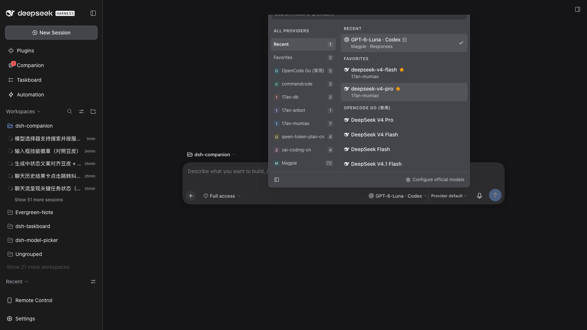

[English](README.md) | [简体中文](README.zh-CN.md)

# dsh-model-picker

Enhanced model picker for the dsh web GUI — replaces the composer's model seat
(`conversation.input.model`).

## Design

A **two-zone trigger button** splits model selection and reasoning-effort
selection into separate popups:

| Zone | Click | Popup content |
|------|-------|---------------|
| **Left** (model name) | Opens the model picker | Search box at top (auto-focused), provider column on the left, model list on the right |
| **Right** (effort) | Opens the effort picker | List of available reasoning-effort levels |

Hovering a zone names what it will act on. The model zone reads
`provider · model`: one model id is routinely served by several providers, so
the name alone does not say where the model runs. The supplier named is the
**display** one, so a selection on a folded `(modlens vision)` route still reads
as its base provider — the same name the user clicked in the column.

The panel is 540px wide and up to 500px tall, and both give way under pressure
rather than overflowing. Its height is clamped against the measured space above
the trigger (which is `50vh + 61px` in the hero layout, checked at six window
heights), minus the panel's own chrome: at a 900px-tall window the panel measures
exactly 500px and keeps an 11px margin from the top edge. When the provider
column folds, the panel gives up that column's width instead of stretching the
model list (see **Configure official models**).

## Supplier chip

A model row leads with the **mark of whoever made the model** — DeepSeek's whale,
Zhipu's mark, Qwen's — on the **closed trigger** as well as on every row in the
list, so which model is in use, and whose it is, reads before the picker is ever
opened. Marks are the published mono cuts from
[`@lobehub/icons-static-svg`](https://github.com/lobehub/lobe-icons) (MIT),
inlined as paths on their own 24×24 grid and filled with `currentColor`.

- The mark names the **model's maker**, not the supplier: `17an-mumiao`,
  `qwen-token-plan-cn` and `opencode-go1` all serve `deepseek-v4-flash`, and the
  question a row answers is "what am I picking". A per-supplier mark would answer
  "who resells it" and, worse, could only ever be a letter for the three `17an`
  floors.
- **Two rules, lab first.** The model's own lab is read from the leading token of
  any `vendor/model`, `vendor:model` or `vendor_model` segment — that is what
  catches `17an-db/deepseek-v4.1-flash`. Only when no lab is named does the
  **host** in the label earn a mark, matched as a whole word, so `Composer 2.5 ·
  Cursor` and `Auto · Cursor` wear Cursor's.
- The order between them is the whole design: `grok-4.7@500k · Cursor` is Grok's
  model resold **through** Cursor, and `DeepSeek-V4.1-Flash · Trae CN` is
  DeepSeek's through Trae. Reading the host first would relabel both with the
  wrong maker — exactly the mistake a mark exists to prevent — so a host mark
  only ever appears on a row whose model segment named no lab at all.
- A row whose maker cannot be named honestly — `Auto · routing group`,
  `Space-Bunny`, `Ling 3.1 Flash Free` — keeps the **supplier's tinted initial**
  instead. The two shapes say different things at a glance: a mark is a lab, a
  tinted uppercase letter is "the picker cannot name this row's maker yet". A
  mislabelled logo would be worse than a letter the panel can always back up.
- The fallback letter is matched by a **fixed prefix list**, deliberately not a
  generic "first word" rule: `mimo` and `hy3` are real families whose ids carry
  no lab in them, so they are listed by name, while a rule loose enough to guess
  them would also hand `auto` a logo it has not earned.
- Supplier floors in the left column keep the **letter on its tint**: a floor
  names a supplier, and `17an-db`, `17an-anbot` and `17an-mumiao` would otherwise
  be indistinguishable. The model list beside it names labs, which have marks.
- The tint is **chosen, not hashed**. A hue derived from the route id produced
  ten unrelated colours in one panel, gave neighbouring suppliers near-identical
  chips, and let the palette drift as providers were added. Each supplier now
  takes a hue from a fixed set by its position in the configured provider order,
  so a hue belongs to a supplier rather than to a moment in time.
- Every chip is held at the **same lightness and chroma** (OKLCH, hue varies
  only). No supplier shouts louder than another, and no supplier's chip can
  vanish into the panel the way a mid-blue one did under a fixed saturation.
- Both shapes take the **surrounding ink** (`color: inherit`), so they are dark
  on the light theme and light on the dark one (12.35:1 and 6.56:1 measured on
  painted pixels). A per-hue glyph colour was tried and removed: a light tint of
  the hue is legible on the dark theme and effectively invisible on the light
  one, which is the theme nobody checks. Full-colour brand marks were declined
  for the same reason the tint is held down: a dozen brand palettes would fight
  the panel's one accent, which is the check mark on the model in use.
- Only the tint carries a hue; a brand mark carries none, because the mark *is*
  the shape and a chip behind it would only make a logo read as a letter.
- The trigger's `max-width` (300px) leaves room for the avatar's footprint (16px
  plus its gap) on top of the name budget, so wearing it costs the model
  name no characters. When the composer row runs short it is the model
  NAME that truncates, never the effort zone: the effort zone reports a state in
  one short word, and a clipped state word is a different string ("Hi..."), while
  a name is free-form, truncates readably, and the tooltip carries it in full.
- The avatar is **hidden from the accessibility tree**: the supplier and the model
  are already named in the trigger tooltip and the row detail, so a mark would
  only repeat them.

## Provider folding

A provider whose name is another provider's name plus a trailing parenthesized
capability suffix folds into that base provider's row. modlens registers vision
as its own provider route (`DeepSeek (modlens vision)`), which would otherwise
put a near-duplicate row per provider in the column.

- Folding is **display-only**: every row keeps its models paired with the group
  that serves them, so picking a folded model still submits that model's own
  provider id.
- The suffix stays on the model name, and a folded model whose route differs
  from its row is labelled with that route, so the two are never confused.
- A suffixed provider whose base is absent keeps its own row.

## Model facts (context window / image input)

The browser catalog the seat reads (`ModelCatalogModel`) carries only
`id / name / description / reasoning` — **no** context window and **no** input
modalities. Both exist on the Host's `llm` service, so the host half
(`lib/host.js`) republishes them over one loopback route:

```
GET /api/model-picker/models
→ { ok: true, models: [{ provider, id, contextWindow?, input? }] }
```

- `resolveModel()` is the only source of `context: { contextWindow }`;
  `listModels()` is the cheaper source of `inputModalities`.
- One row per provider/model is isolated: a provider or model that throws is
  dropped, and a row carrying neither fact is omitted entirely.
- The snapshot is cached for 30s — the route never fans out per keystroke.
- The popup badges each row with an image glyph, which rides **after the model
  name** because input modality is a property of the model, and with a context
  chip (`1M`, `384K`) in the trailing strip, where the numbers line up as a
  column you can compare down. Both are joined on `provider/modelId`.
- **Vision.** A plain glyph means the model reads pixels itself. A glyph with a
  slash across it means the route accepts images only because modlens bridges
  them: the model still cannot see — modlens transcribes the image to text
  first. The `(modlens vision)` suffix is what tells the two apart.
- The slash, rather than a dimmed glyph, is deliberate. Fading the glyph to
  carry "this model cannot see" put it under the 3:1 floor for non-text
  graphics and erased the distinction entirely in greyscale. A shape difference
  survives low vision, greyscale and both themes; a lighter grey does not.
- The modlens suffix is *not* the general vision signal: modlens declines to
  wrap a model whose id already carries a vision marker, whose catalog
  declares image input, or that falls outside its configured families. A row
  with no suffix can therefore be natively vision-capable; the glyph, not the
  name, is the answer. With modlens disabled the folding and the bridge glyph
  are simply dormant — nothing is suffixed.
- Before the host half has been restarted the route 404s, so the context chip
  and native-vision glyph are missing until then.

## Grouped list (elevator)

The right column is always one grouped list: **Recent** (`最近使用` in a Chinese UI — the route history, pinned at the top once it has entries), **Favorites** (`收藏` — the starred models, another mirrored copy), then every provider's group. The left column is a table of contents to this list.

- Scrolling the right column highlights the left row for the section pinned at the list's top edge (scroll spy / elevator). The group headers are `position: sticky`, so the left row always matches the header you see.
- Clicking a left-column supplier jumps the list straight to that group — an instant landing, not an animated ride: the elevator is a table of contents, and the time spent travelling is time nobody asked for. During a search, clicking a supplier **narrows** the results instead (search facet).
- Groups are separated by their sticky heading alone. A hairline rule per group was drawn across the list every few rows and earned nothing, so there is none.
- A group heading is its **label and nothing else**. It used to wear a pictogram (a clock for the history, and one building glyph shared by every supplier *and* the favorites). A building does not read as "supplier", the favorites group has no building in it, and the label already said which group you were in, so the icons were removed.

## Recent

The panel opens on the models used lately, with **the route in use at the front** — so switching back to the previous model is one `Enter` away from opening the popup. Every history row names the provider serving it, because the group spans suppliers.

- What is recorded is **the current route the directory reports**, not the rows clicked in this popup: a switch made in this list, in the shipped `/model` popup, or by a session reopening on its own model all count as "used" — the history answers "what have I been using", not "what did I click in this panel".
- Keyed on the **route** (`provider/modelId`), deduplicated and fixed-length (6 entries): reusing a route only moves it to the front instead of taking a second slot.
- It lives in `localStorage` under `dsh.modelPicker.recent`, with the same conventions as the favorites. A route that is no longer configured (provider uninstalled, model retired) stays in storage but is **not rendered**: the record comes back with the provider, and the list never shows a model that is not there.
- An empty history shows neither the group nor its floor, and an empty favorites group does the same: a heading with nothing under it is a promise the panel cannot keep. The favorites floor goes with its group, since a floor that jumps to a section which is not rendered would scroll the list nowhere. Starring one model brings both back.

## Favorites

Every model row carries a `☆` / `★` toggle **after the model name**, and after the vision mark when there is one, so a row reads as a name followed by its marks: what the model accepts first, then the action you can take on it. The row is itself a `<button>`, so the star stops its click from reaching it — favoriting a model must never also pick it — and it handles `Enter` / `Space` on its own.

- The star is **revealed, not always present**. Favoriting is something you do to a row, not part of what the row says, so the star stays unpainted until the row is hovered or holds keyboard focus. Its box keeps its place either way, so revealing it never shifts the row under the pointer, and only a pointer that can actually hover hides it: on a touch screen it would be permanently unreachable, so there it stays visible.
- A **favorited** row always shows its star. That star is state rather than an invitation, and hiding it would hide the answer.

- Favorited models appear **twice** in the list: once in their provider's group, and once in the favorites group pinned at the top of the list. A favorites row always names the provider serving it.
- Favorites are keyed on the **route** (`provider/modelId`), not the bare model id: one model id is routinely served by several configured providers, and favoriting one route says nothing about the others.
- They live in `localStorage` under `dsh.modelPicker.favorites`, the same place the shipped conversation plugin keeps its own view and width preferences. A storage refusal (private mode, full quota) is swallowed: the in-memory set still tracks the page.

## Failover (one click to recover a failed turn)

The scenario: a turn dies — the route ran out of quota, got rate limited, or the
Agent failed partway through — and the user has to pick a model that still works
and then retype "continue". That retyping is what this removes.

**The design rule is visibility.** This is a rare event, so it must not touch
ordinary model switching at all. Nothing is rendered on a healthy session: there
is no standing toggle to arm, no per-row mark, no menu entry. Instead a small
button appears beside the composer **only while a failure is live**, and only
when a fallback model has been designated. With either half missing the control
does not exist — so "no fallback set" means no button, never a button that cannot
act.

**One click does both halves.** The button switches to the fallback model and
then sends the repair. The switch is committed first and awaited, because sending
the repair on the old model would repair in exactly the place that just failed;
if the switch does not take, nothing is sent.

**Two failure shapes, two different repairs.** They are told apart using the
session's own public snapshot, and the button labels itself accordingly:

| Failure | Signal | Repair |
| --- | --- | --- |
| **Send** — the prompt never left the client | `promptError.op === 'send'` | the **original words are replayed verbatim**, read back from the session log |
| **Agent** — accepted, then failed or was interrupted mid-turn | `lastAgentError`, or a final `assistant/message` with `interrupted === true` | a **resumption instruction**: check what actually completed, then continue |

Collapsing these into one "continue" would be wrong in the case that matters. A
send failure left nothing behind, so re-sending the same request is exactly
right. An agent failure may have left tools half-run and files half-written, so
re-sending the request reads as a fresh instruction and risks redoing finished
work — that repair instead tells the model to inspect the current state first.
A bare "continue" is deliberately never used, because it reads as new input.

**Designating the fallback.** Every model row carries a mark next to the star
which sets that route as the fallback; one route at a time, and clicking the
marked row again clears it. It follows the star's rules: reserved space, revealed
on hover or keyboard focus, always visible once set. It persists in
`localStorage` under `dsh.modelPicker.fallback`.

**It retires itself.** The failure state is read through the Session's own
`subscribe`/`getSnapshot` pair, so the button appears the moment the Host reports
a failure and disappears the moment `prompt()` clears it — no polling, and no
extra bookkeeping to keep the two in step. Clicking repairs once; a rejected
submission says so and stays retryable rather than latching as done. Everything
is submitted with mode `queue`, so a repair never interrupts a live turn.

Best-effort throughout: an unreachable session, a released reference, or a stale
fallback route that this session no longer lists leaves the rest of the picker
working and reports why, rather than sending the work nowhere.


## Configure official models

The popup carries one fixed row under its body: **Configure official models →
Settings · Models**. The picker can only list what the configured providers
offer — it cannot add the official DeepSeek route, sign the account in, or store
an API key — and the moment that page is needed is exactly when this panel is
open, so the panel is where the way to it belongs.

- The row is a direct child of the popup, **outside the scrolling list**: a row
  that scrolls away is a row the user cannot find when the models are missing.
  The body gives up its ~36px, never the row.
- It opens Settings **on the 模型 / Models section in one step**, not on whatever
  section was open last. The settings modal owns its open/active state, and
  publishes it through the store handle its `sidebar.settings` seat registers;
  the picker writes `openSection('models')` to that handle — the same state
  change a click on that nav row makes.
- A carrier whose settings seat carries no store falls back to running the
  panel's own `settings.open` command and then lighting its 模型 row, named by
  the label the `settings.section` ledger publishes (so the fallback follows the
  UI's locale instead of hard-coding a string).
- With neither — no settings UI in this deployment — the row does nothing rather
  than closing the picker onto an empty page. The picker closes only once the
  panel has actually opened.
- The hand-off is read through *this* plugin's own inject set (`slots`, plus the
  optional `shortcuts` service via `ctx.get`), never the caller's, and it can
  never throw into a click handler.

The same row carries one more control: a **provider-column toggle** (the
outlined-panel glyph) that folds this panel's own left column away and back.

- It folds **this popup's** provider list, which is the panel's table of
  contents. It is not the application's sidebar: that one belongs to the layout
  plugin, and this column belongs to the picker.
- Folded, the **popup narrows by the column it gave up** (measured: 550px to
  362px), anchored to the same right edge. The model list keeps the width it had
  rather than stretching into the space: a column that folds should remove
  space, not redistribute it, and it is the reading width of the list that
  should not change. The divider that separated the two columns leaves with the
  column it belonged to.
- The fold is a **view preference**, remembered in `localStorage` under
  `dsh.modelPicker.providersHidden`, the way the favorites and the history are.
  It is not folded by default: the column is the panel's map, and a map the user
  never asked to lose should be there on the first open.

## Language

The panel is written in the **app's** language — the one the user picked in
Settings → General → Language — never in the browser's. A user who chose 中文
inside DSH gets 中文 here even when the browser reports `en-US`, and the reverse
holds too.

- The source chain is: the `locale` service (the actual preference, and the
  value every other surface reads) → `document.documentElement.lang` (the
  shell's own declaration of the language it is rendering, which the locale
  plugin rewrites on every switch) → `navigator.language` (the pre-boot default
  only). Each step is guarded, so a carrier missing one still gets a language.
- Switching the language re-renders the panel **while it is open**: the copy is
  read through a subscription to that source, so nothing waits for a reload or
  for the next open.
- The dictionary is deliberately small — two languages, one flat key set — so
  the panel never depends on a locale namespace being registered before it
  renders, and it cannot break the composer seat when one is missing.

## Search semantics

The query is a facet over **both** columns, not just the model list:

- A provider matches by its display name, its route id, or by having at least one matching model. The provider column narrows to the matching providers and each badge shows that provider's match count.
- With no provider selected, the model list spans every matching provider and labels each row with its provider.
- Clicking a provider during a search narrows the list to that provider without clearing the query. Typing a new query clears the previous provider facet.

Model and effort data ride the same per-session `ModelDirectory` as the `/model`
popup, so a switch in either surface is what the other shows next.

## Keyboard

The picker is search-first, so focus never leaves the search box: the popup is
drivable end to end without tabbing through rows. The caret is the whole focus
cue — the box keeps its resting border in every state, because it holds focus
for the panel's entire life and a lit border would read as a state to clear.

- The popup opens with the **cursor** already on the first row — the route used
  last; an empty group (no history yet, nothing starred) contributes no row, so
  it is skipped rather than stood on. The cursor is not the current model: the
  check mark reports what is in use, the cursor reports where the next `Enter`
  lands.
- `↑` / `↓` move one row, `PageUp` / `PageDown` ten, `Home` / `End` jump to the
  ends. The cursor holds at both ends instead of wrapping.
- `Enter` commits the cursor row and closes the popup, handing focus back to the
  trigger. Typing a new query puts the cursor back on the first match.
- The cursor is the hover surface and nothing else — no rail, no border. The
  list scrolls it into view, and `scroll-margin-top` keeps the sticky group
  header from covering the row it scrolled to.
- The search box names the cursor row in `aria-activedescendant`, so the
  position is announced even though DOM focus never moves.
- Favorites stay reachable: `Tab` to a row's star and press `Enter` / `Space` to
  toggle it without picking the model.

## Contrast and hierarchy

Every text element in the panel clears WCAG AA (4.5:1) **measured on painted
pixels**, not on declared colour values. The panel does not carry a second,
quieter grey: it uses the host's own `label-secondary` for metadata and separates
tiers by form instead (14px/500 for a model name, 12px/400 for a row detail,
11px/600 with `.06em` tracking for a group heading).

Three cheaper ways to get a "dimmer than body" ink were tried and rejected, all
of them measurable:

| Approach | Measured | Why it fails |
|---|---|---|
| `opacity: .6` on the element | 2.63:1, and 2.25:1 over a hover row | Composites against whatever is behind it, so one value yields several ratios; it also fades a glyph's anti-aliased edge as much as its body |
| `color-mix(… , transparent)` | 2.58:1 | Keeps an **alpha** channel instead of darkening, so every painted pixel is lighter than the ink it names |
| `color-mix(… , <panel surface>)` | 4.14:1 on a light hover row | The mix is relative to a surface, and in the light theme the hover row is *darker* than the panel, so the direction inverts |

`label-secondary` clears the floor on all four surfaces this panel can put text
on: 6.37:1 and 5.04:1 in the dark theme, 5.50:1 and 4.94:1 in the light one.

Two further decisions follow the same rule, that a state should be carried by
something other than a slight change in brightness:

- The checked image glyph is struck through, not dimmed (see **Vision** above).
- The selected provider row and the list's keyboard cursor use the same neutral
  surface. The panel's single accent is the check mark on the model in use; an
  accent-filled provider row made `--dsw-alias-brand-primary` (which resolves to
  near-white here) fight the glyph for the eye.

Two rules keep a row readable once its hover surface is a filled rounded rect:

- Rows are separated by a **2px gap**, not by their surfaces alone. The surfaces
  touch edge to edge, so two adjacent highlighted rows used to fuse into one
  block and read as a single control.
- A row's detail line shares the **model name's left edge**, not the chip's. The
  chip is a marker ahead of the name, so both text lines align; the indent is
  derived from the chip's own size, so it cannot drift away from it.

Motion is one chevron turn at 160ms on a strong ease-out curve, plus colour lifts
on press and hover. The turn is dropped under `prefers-reduced-motion`; the
colour changes stay, because they aid comprehension rather than being motion.

## Test

`npm test` runs both halves:

- `scripts/interaction.mjs` drives the browser half in jsdom through its real
  loader entry: opens the model popup, types provider and model names, asserts
  that both columns filter, that a provider facet keeps the query, that the
  popup opens with the keyboard cursor on the first row and walks it with
  `↑`/`↓`/`PageUp`/`PageDown`/`Home`/`End` until `Enter` commits it, and that the
  fact badges land on the rows the fact route describes. The history is asserted
  row by row as well: it records the route in use, moves a reused route to the
  front without duplicating it, stops at its cap, and leaves an unconfigured
  route in storage but out of the list. The fake context enforces cordis's
  `without inject` rule, so a missing service declaration fails the test instead
  of the live seat. It also asserts every icon is an **SVG**, never a text emoji
  or symbol character, in the closed trigger and in both popups, and that the
  search box declares no focus border — jsdom answers no `:focus` through
  `getComputedStyle`, so the stylesheet text is what this half can check. The
  avatar is covered from both ends: every id shape that has to resolve a lab
  (`glm-5.3-flash` by id, `deepseek/deepseek-v4-flash-vision-exp` after a
  `vendor/` prefix, `MiniMaxAI/MiniMax-M3` in the vendor segment, `hy3` by family
  abbreviation) does resolve one, the two anchor pairs (`DeepSeek Chat` vs the
  vendor-prefixed id, `GLM-4.6` vs `glm-5.3-flash`) wear the *same* mark, distinct
  labs wear *different* marks, a host-only label (`Composer 2.5 · Cursor`) earns
  the host's mark — and, the case the two rules exist for, a resold lab
  (`Grok 4.7 @ 500k · Cursor`, `DeepSeek-V4.1-Flash · Trae CN`) keeps the **lab's**
  mark rather than the host's. A row naming no lab at all keeps the supplier's
  tinted initial, at a curated OKLCH hue. Supplier floors are asserted to keep the
  letter and a distinct hue each, so the two shapes cannot drift into one. The
  settings
  hand-off is covered the same way: the footer sits outside the scroll area,
  clicking it writes `models` to the settings seat and closes the popup without
  picking a model, the no-store carrier falls back to the `settings.open` command
  plus the ledger's own nav label, and a carrier with no settings UI leaves the
  picker open. The language is asserted against an **English browser**: the copy
  must follow the app's declaration, an open panel must re-render when it
  changes, the `locale` service must outrank the document attribute, and a render
  that arrives with no locale source at all must still follow the document.
  Failover is asserted on both sides, and the negative side carries the most
  weight because the whole point is that a rare failure must not disturb ordinary
  switching: a clean session renders **no button at all** (with and without a
  fallback set), and a live failure with no fallback set renders none either. On
  the positive side one click must both switch to the fallback and send the
  repair, in that order; a send failure replays the original words while an agent
  failure sends the resumption instruction under a different label; a final
  interrupted message counts as a failure; and the button **retires itself** once
  the failure clears, which is the behaviour that keeps it out of the way without
  any extra bookkeeping. Also pinned: a stale fallback route reports instead of
  switching to nothing, a rejected submission is reported and stays retryable
  rather than latching as done, the designation persists and clears on a second
  click, a legacy `{route, enabled}` record still yields its route, and an
  unreachable session leaves the picker listing models normally.
- `scripts/host-route.mjs` drives the real route handler with a stub `llm`:
  asserts the row shape, that a throwing provider/model is isolated, and that
  the 30s cache answers without re-listing.

**Icon alignment.** An inline `<svg>` sits on the text baseline, so the font's
descender space below it lifts the glyph above the centre of its own line box —
which is what knocks a chevron or a check mark off the text's horizontal line.
`.dsh-mp2-root svg{display:block}` removes that space, and each icon wrapper
centres its contents, so an icon's centre lands on the text's centre line.

`node scripts/probe.mjs` checks the real thing: it opens the running GUI
(`DSH_COOKIE_JAR`, default `/tmp/dsh-cj.txt`, holds an authenticated session
cookie), asserts the component mounted into the seat, opens the popup, measures
that the panel does not resize while the query narrows, and writes
`live-model-picker.png`.

`node scripts/verify-live.mjs` drives the running Web GUI with Playwright — it
forges the same signed browser-session cookie the host mints — and checks what
jsdom cannot: the cursor row's computed background, that the search box paints
its resting border rather than the accent one while it holds focus, that a
supplier click lands instead of animating, and that the footer's hand-off really
opens Settings on the Models section. It also measures the first row's avatar in
a real browser: the mark must have a non-zero, non-overflowing box, keep its
`fill-rule="evenodd"` (without it an outline mark like Qwen's fills its own
counters), paint in a real colour rather than a transparent fill, carry no chip
behind it, and render no letter beside it. It closes the panel again, so a run
leaves the session as it found it. It targets the `web` profile on `:3080` by
default; `DSH_LIVE_ORIGIN=http://127.0.0.1:19387` points it at the desktop app
instead, which serves its own installed copy of `lib/client.js` — a change has to
be carried into that profile before the run can see it.

`node scripts/screenshot.mjs` regenerates the README image. It stars two models
from different suppliers first — the favorites group is the feature a still image
has to show, and it is empty on a fresh browser profile — and refuses to write a
shot whose favorites group came out empty. Override the output with `SHOT_OUT`,
and the shell it photographs with `DSH_LIVE_ORIGIN` (same default and same reason
as `verify-live.mjs` above). It mints its own session cookie rather than reading
one from a file, and it shoots at a viewport tall enough to fit the whole popup:
the panel's height is clamped against the window, so a short window crops its
last rows mid-word.

## Slot

Injects into `conversation.input.model` (declared by
`@deepseek-ai/dsh-client-ui-conversation`).

## Inject contract

The seat is a **single** slot, so this entry shadows the shipped
`ModelSelect` — a registration that crashes leaves the composer with no model
control at all. cordis rebinds a service proxy's `this.ctx` to the **caller**,
so every face of `ctx.modelDirectories` (`directoryFor`, `load`, `select`) reads
`remote.session` through *this* plugin's inject set. The declaration is
therefore:

```js
const inject = ['slots', 'sessions', 'modelDirectories', 'remote', 'remote.session']
```

Dropping `remote` / `remote.session` throws
`cannot get property "remote.session" without inject` inside the seat's inject
factory; the entry abdicates and the enhanced picker never appears.

## Third-party assets

The brand marks a model row can wear are the published mono cuts from
[`@lobehub/icons-static-svg`](https://github.com/lobehub/lobe-icons), MIT
licensed, inlined into `lib/client.js` as path data. They are the official marks
rather than redrawn approximations, and only the ones a configured route can
resolve to are carried — each is attributed to LobeHub in the source block it
lives in. The interface glyphs (star, check, chevron, panel toggle, image,
settings, external) are [Lucide](https://lucide.dev), ISC licensed, inlined the
same way. No icon font and no runtime icon dependency is installed.
